# Wavelet: Music Streaming App UI

Wavelet is a music streaming app designed to be calm, clear and easy to use. The goal: **any song within 3 taps, and playback always 1 tap away**, on both mobile and desktop.

- **Figma file (design system, wireframes, final UI, clickable prototype):** https://www.figma.com/design/jVc6M1gpwdNEPC2my4Utud

<p align="center">
  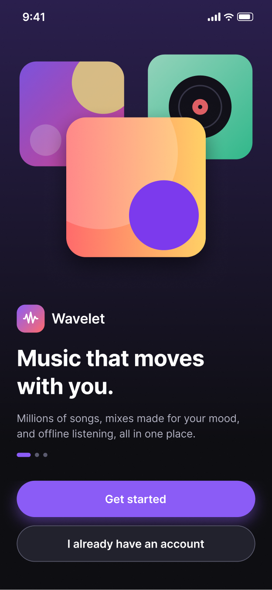
  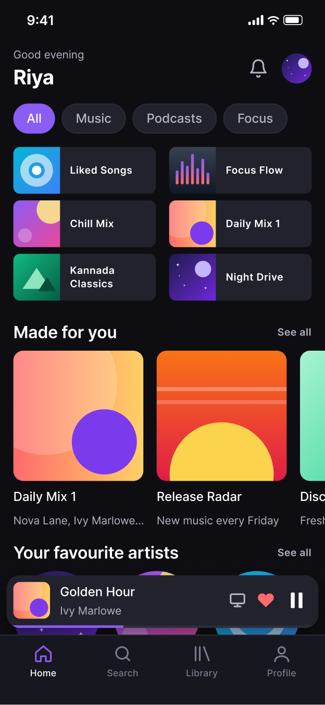
  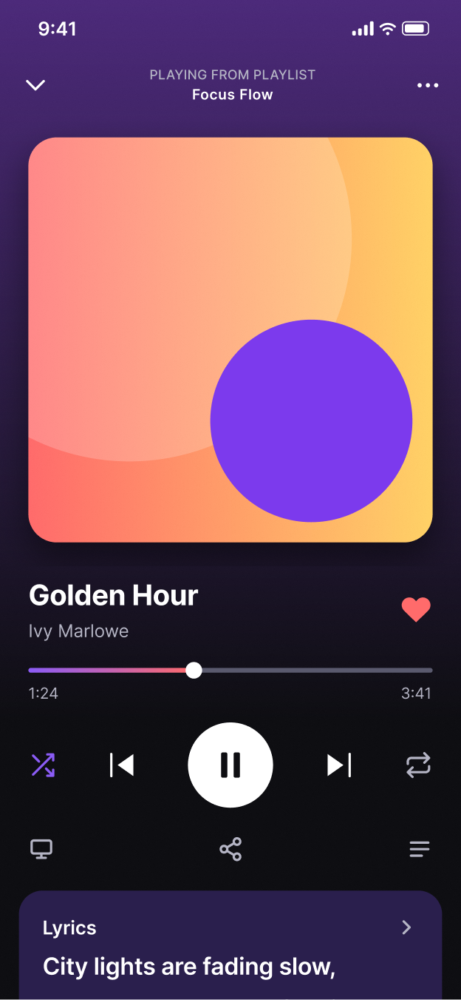
</p>

## What's in the Figma file

| Page | Contents |
|---|---|
| 01 Cover & Design System | Cover, foundations (30 color, spacing and radius variables, 9 Inter text styles, 2 effect styles), 35 icon components, 8 generative album-art covers, 16 components with variants |
| 02 Sitemap & Wireframes | UX brief (problem, 2 personas, business functions, design principles, UX metrics), sitemap, main user flow, 6 low-fi wireframes |
| 03 UI Screens & Prototype | 9 mobile screens (390 × 844), 2 desktop screens (1440 × 900), 64 prototype links |

To try the prototype, open page 3 in Figma and press **▶ Present**.

## Design process

1. **Research:** personas, needs and business functions
2. **Sitemap:** a shallow structure with 4 tabs, at most 3 levels deep
3. **Wireframes:** grayscale layouts of 6 key screens
4. **Visual design:** tokens, components and 11 final screens
5. **Prototype:** clickable flows between all screens
6. **Measure:** UX metrics and a usability test plan

### Sitemap

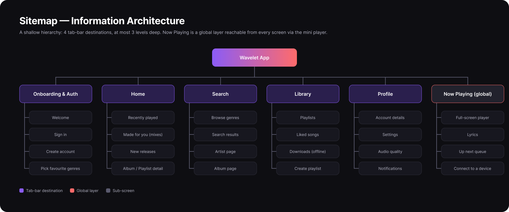

### Wireframes

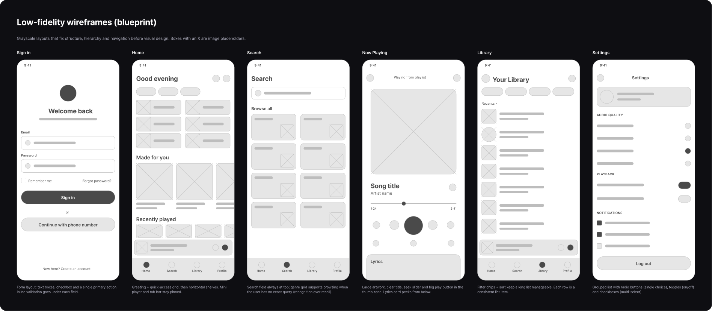

## Mobile screens

| Welcome | Sign in | Home |
|---|---|---|
|  | 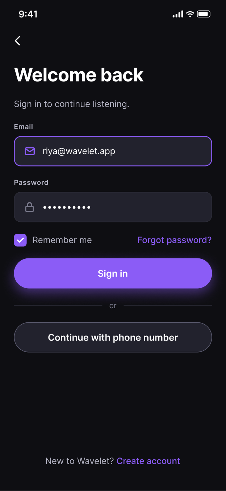 |  |

| Search | Now Playing | Up Next |
|---|---|---|
| 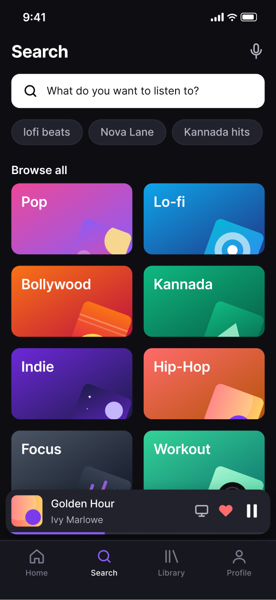 |  | 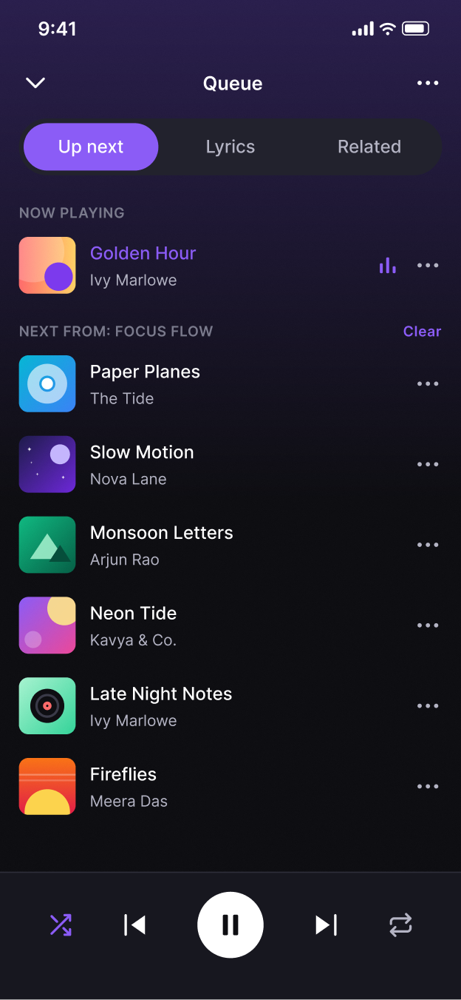 |

| Library | Playlist | Settings |
|---|---|---|
| 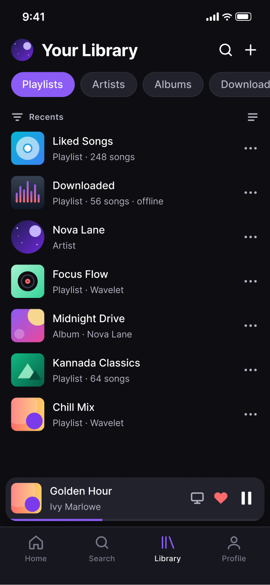 | 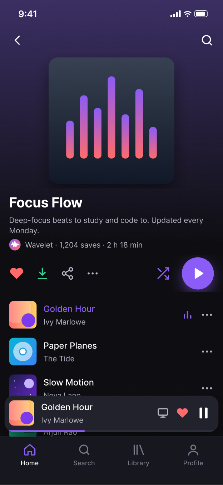 | 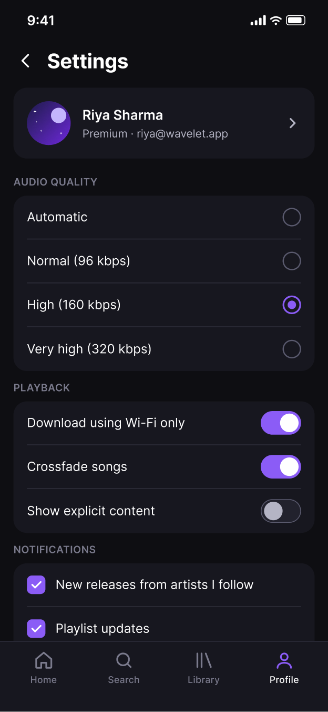 |

## Desktop screens

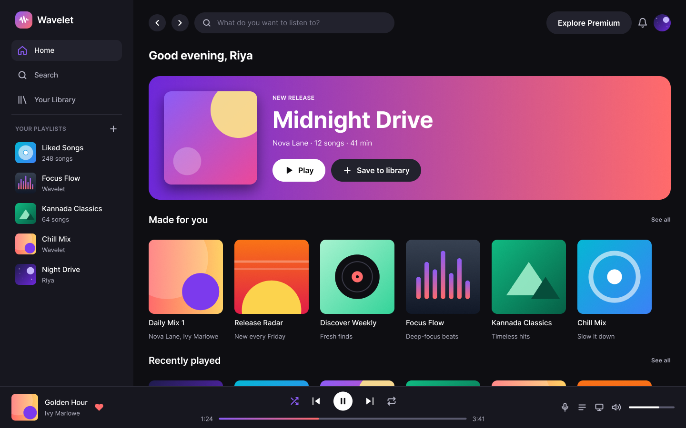

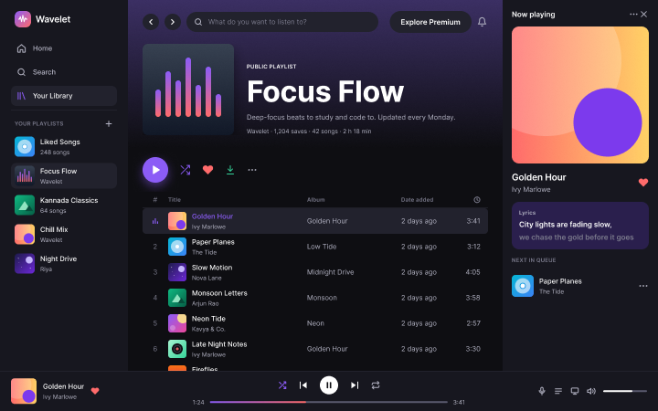

## Design system

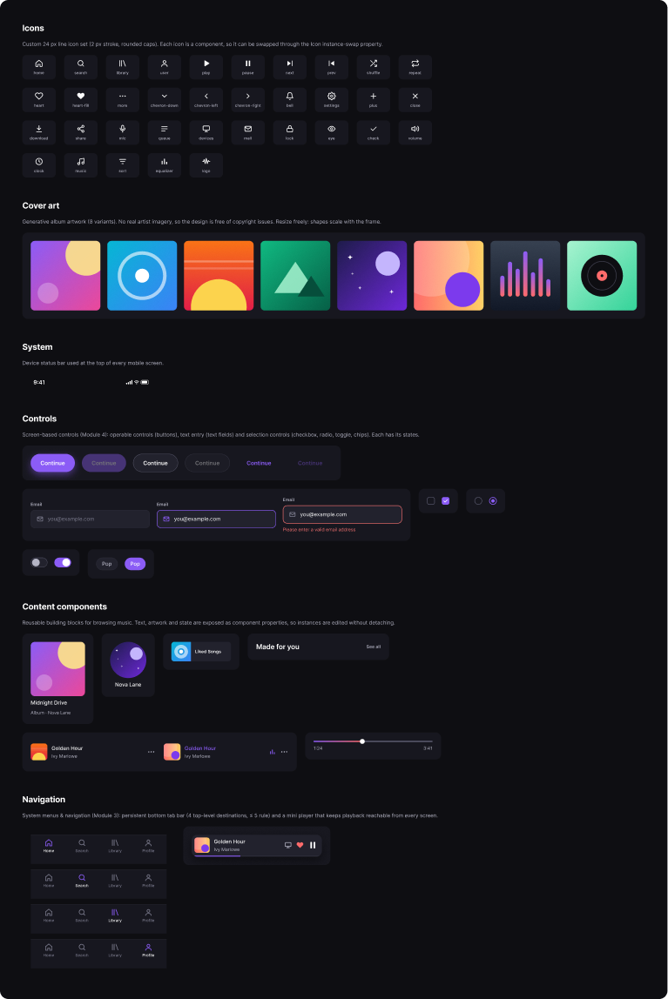

- **Colors:** dark theme (`#0E0E12` base) with a violet accent (`#8B5CF6`), plus coral and mint
- **Typography:** Inter, 9 text styles from 11 px to 32 px
- **Spacing:** 8-point grid; corner radius 8 / 12 / 16 / 24
- **Components:** Button, Text Field, Checkbox, Radio, Toggle, Chip, Album Card, Artist Avatar, Playlist Tile, Section Header, Track Row, Seek Slider, Tab Bar, Mini Player, Status Bar, Cover

## UX metrics (targets)

These are design targets, not test results.

| Metric | Target |
|---|---|
| Task success: find and play a song | ≥ 90 % |
| Time from Home to playback | < 20 s |
| Taps to resume music | 1 |
| Sign-in form error rate | < 5 % |
| System Usability Scale (SUS) | ≥ 80 |

## Repository layout

```
screens/mobile/    9 mobile screen exports
screens/desktop/   2 desktop screen exports
docs/              sitemap, wireframes and components board exports
presentation/      source of the 17-slide presentation deck (slide HTML + index)
```

The slide files in `presentation/` reference images by their upload IDs in the deck viewer, so they render only there. The same images are in `screens/` and `docs/`.

## Notes

All song titles, artists, lyrics and album art are original placeholders made for this project. No real artist imagery is used.
